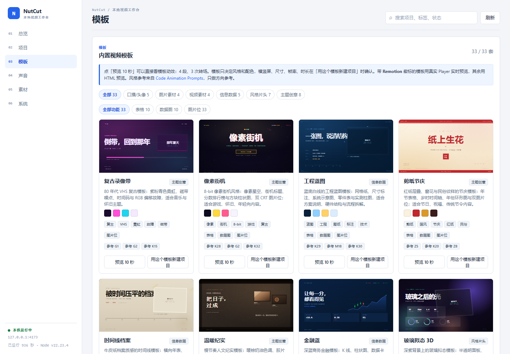

# NutCut

**本地优先的 AI 视频工作台**：MiniMax 声音克隆 / TTS / 生图 + HTML 模板 + Remotion 预览 + FFmpeg 合成 + 本地中控台。




NutCut 把「素材 → 规格 → 文案 → 声音 → 画面 → 混音 → 成片」做成一条 Agent 可执行、可复现、可检查的本地流程。模板负责风格，Agent 负责内容，所有产物都是本地文件。

不依赖云渲染，不需要数据库，也不上传你的素材。

## 特性

- **规格先行**：模板只决定风格；横竖屏、尺寸、帧率、时长在项目级 `spec` 确认，缺一项就拦下来。
- **33 套独立模板**：口播/头像、图片、视频、信息数据、风格片头、主题创意 6 类，每套有独立版式和动效。
- **Remotion 实时预览**：9 套模板用 `@remotion/player` 播放，可暂停、拖动、重播。
- **两种渲染路径**：HTML 模板逐帧渲染；视频改片支持 EDL 混剪和口播画中画。
- **本地声音链路**：MiniMax 声音克隆、逐句 TTS、ASR、BGM ducking、-16 LUFS 响度归一。
- **Agent 友好**：`AGENTS.md` + `skills/nutcut/SKILL.md`，安装后一句话接手项目。
- **中控台**：模板预览、项目详情、文案/声音/素材查看、问题记录、导出成片。

## 技术栈

| 层 | 实际使用 |
|---|---|
| 运行时 | Node.js 20+，ES Modules |
| 中控台 | Node `http` + 原生 HTML/CSS/JS，无前端框架 |
| 模板 | HTML / CSS / Canvas，OpenMotion 模板合同 |
| 渲染 | Puppeteer-core + Chrome/Edge 逐帧截图，FFmpeg / FFprobe 合成 |
| Remotion | Remotion 4、React 19、`@remotion/player`、`@remotion/bundler`、`@remotion/renderer`、esbuild |
| AI | MiniMax Voice Clone、T2A `speech-2.8-turbo`、H3-Image、ASR `asr-1.0` |
| 数据 | 本地 JSON / MP4 / WAV，无数据库 |
| 测试 | Node.js 内置 test runner |

Remotion 目前用于**模板预览**，成片默认仍由 HTML 模板 + FFmpeg 渲染；详见 [docs/remotion.md](docs/remotion.md)。

## 环境要求

- Node.js 20+
- FFmpeg / FFprobe
- Chrome 或 Edge
- MiniMax Key（只有声音克隆、TTS、生图、ASR 需要）

## 快速开始

```bash
git clone https://github.com/N0tsLabs/nutcut.git
cd nutcut
npm install
cp .env.example .env      # Windows: copy .env.example .env
node bin/doctor.mjs
node console/server.mjs
```

打开 <http://127.0.0.1:4173>。

`doctor` 会区分必需项和可选能力：没有声音档案 / Key 时，仍然可以用原声或无配音项目开始。

## 使用

### 新建项目

模板只决定风格，必须显式给规格：

```bash
node bin/new-project.mjs --id my-video --title "我的视频" --template tech-neon \
  --orientation portrait --quality 1080p --fps 30 --duration 30 \
  --platform douyin --audio source
```

缺少横竖屏、尺寸、帧率或时长时，命令会拒绝创建，并列出需要先问用户的问题。

### 出片

```bash
node bin/voice.mjs --project projects/<id>
node bin/timeline.mjs --project projects/<id>
node bin/audio-mix.mjs --project projects/<id>
node bin/produce.mjs --project projects/<id>
```

### 模板与预览

```bash
node console/server.mjs
```

- 模板页支持 10 秒实时预览
- 带 `Remotion` 徽标的模板使用 Player 预览
- 带 Remotion 徽标的模板当前是 `previewOnly`，新建项目使用 HTML 版

### 视频改片

```bash
node bin/analyze-video.mjs --file "D:/素材/口播.mp4" --out projects/<id>/analysis
node bin/remix-plan.mjs --analysis projects/<id>/analysis/analysis.json --out projects/<id>/edl.json --title "标题"
node bin/assemble.mjs --edl projects/<id>/edl.json --out out/<id>/film.mp4
```

口播画中画：

```bash
node bin/frame-video.mjs --project projects/<id>
```

### 交给其他 Agent

```text
把 <仓库路径> 安装成你的 NutCut 技能，然后按它接手项目。
```

```bash
node bin/install-skill.mjs --target opencode
node bin/install-skill.mjs --target claude
node bin/install-skill.mjs --dest <agent-skills-dir>/nutcut --force
```

在 OpenCode 中从仓库根目录打开时，`opencode.json` 会自动发现 `skills/`。

### 自测

```bash
npm test                      # spec / 项目创建 / 技能 / doctor / API 门槛
node bin/check-templates.mjs  # 33 套 HTML 模板逐套渲染
node bin/doctor.mjs
```

## 目录结构

```text
NutCut/
  AGENTS.md              Agent 规则
  workflow.json          10 阶段工作流
  bin/                   渲染、声音、混音、项目、状态、安装脚本
  console/               本地中控台 + 项目详情页
  templates/             33 套 HTML 模板
  remotion/              9 套 Remotion 预览 composition
  skills/nutcut/         Agent 技能
  projects/              项目工程（JSON + src + 本地素材）
  docs/                  流程、Remotion、交接和风格文档
  test/                  自测
```

## 文档

- [Agent 接入](AGENTS.md)
- [新 Agent 30 秒启动](docs/agent-quickstart.md)
- [交接给其他 Agent](docs/agent-handoff.md)
- [视频制作流程](docs/video-workflow.md)
- [Remotion 预览与渲染](docs/remotion.md)
- [模板说明](templates/README.md)
- [风格参考](docs/style-references.md)

## 边界

- Remotion 预览目前不负责项目成片导出；成片走 HTML 模板。
- 不包含云渲染、在线协作、内置时间线剪辑器。
- `.env`、声音参考、用户素材、分析中间产物不提交仓库；交接时需要单独传。
- `library/` 只提交 catalog 和说明，音频文件不提交；本地使用请按来源自行放置。

## 许可

MIT，见 [LICENSE](LICENSE)。第三方素材与工具许可见 [NOTICE.md](NOTICE.md)。
